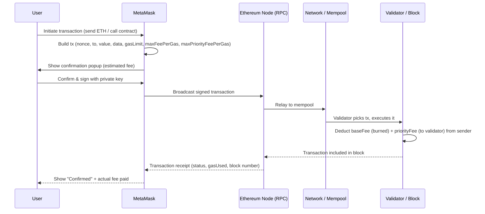

# Assignment 1: Installation of MetaMask and Study of Spending Ether per Transaction

## Aim
Install MetaMask and study how spending Ether per transaction works (gas, gas price, transaction fee).

## What is MetaMask

MetaMask is a browser-extension / mobile crypto wallet that also acts as a bridge between a normal web browser and the Ethereum blockchain (and other EVM-compatible chains). It stores private keys locally (encrypted with a password, derived from a seed phrase), lets a user sign transactions, and injects a `window.ethereum` provider object into web pages so decentralized apps (dApps) can request account access and ask the user to sign transactions.

## Installation Steps

1. Open the browser's extension store (Chrome Web Store / Firefox Add-ons) and search "MetaMask". Only install from the official listing (`metamask.io` links to the correct store page) — fake lookalike extensions exist.
2. Click **Add to browser** / **Install**, then pin the extension icon to the toolbar.
3. On first launch, choose **Create a new wallet** (or **Import an existing wallet** using a seed phrase — covered in Assignment 2).
4. Set a strong local password. This password only unlocks MetaMask on *this* browser; it is not the same as the seed phrase.
5. MetaMask shows a 12-word **Secret Recovery Phrase**. Write it down offline and confirm it when prompted.
6. Once set up, MetaMask defaults to the **Ethereum Mainnet**. For practice without spending real money, switch the network dropdown to a testnet, e.g. **Sepolia**.
7. To get test ETH, copy the wallet address (starts with `0x...`) and paste it into a Sepolia faucet (e.g. a faucet site that drips free test ETH per request). Test ETH has no real value — it exists purely so the gas model can be exercised safely.
8. Confirm the balance appears in MetaMask after the faucet transaction is mined (usually under a minute on a testnet).

## How Spending Ether per Transaction Works

Every state-changing operation on Ethereum (a plain ETH transfer, or a smart-contract call) consumes **gas** — a unit that measures computational work. The payer is the account that signs and sends the transaction.

### Key terms

| Term | Meaning |
| --- | --- |
| **Gas** | Unit of computational effort. A simple ETH transfer costs a fixed 21,000 gas. Contract calls cost more, depending on the opcodes executed (storage writes are the most expensive). |
| **Gas Limit** | The maximum gas the sender is willing to let the transaction consume. Unused gas (limit − used) is refunded. If execution needs more gas than the limit, the transaction reverts but the gas already consumed is still charged ("out of gas"). |
| **Gas Price / Base Fee** | Since the **EIP-1559** upgrade, each block has a protocol-determined **base fee per gas** (burned, not paid to anyone) that rises or falls depending on how full the previous block was. |
| **Priority Fee (tip)** | An extra amount per gas the sender offers on top of the base fee, paid directly to the miner/validator, to be prioritized sooner. |
| **Max Fee per Gas** | The absolute ceiling the sender agrees to pay per gas (covers base fee + tip). Any difference between max fee and (base fee + tip) is refunded. |

### The fee formula

```
transaction fee = gasUsed * gasPrice
gasPrice (EIP-1559) = baseFeePerGas + priorityFeePerGas   (capped at maxFeePerGas)
```

### Worked numeric example

Suppose a plain ETH transfer (gasUsed = 21,000), with:
- Base fee = 30 gwei
- Priority fee (tip) = 2 gwei
- So effective gas price = 32 gwei

```
fee = 21,000 gas * 32 gwei/gas
    = 672,000 gwei
    = 0.000672 ETH
```

(1 ETH = 1,000,000,000 gwei.) If the sender had set `maxFeePerGas = 50 gwei`, they would still only be charged the actual 32 gwei/gas — the other 18 gwei/gas headroom is simply unused ceiling, refunded automatically.

A smart-contract call that writes to storage (e.g. the bank contract's `deposit()` in Assignment 3) consumes far more than 21,000 gas because each `SSTORE` opcode (writing a new value to contract storage) alone costs thousands of gas.

## Transaction Flow (MetaMask -> Network -> Receipt)



## Observations

- `gasUsed` in the receipt is always ≤ the `gasLimit` set before sending.
- A failed/reverted transaction still charges gas for the work done up to the point of failure.
- Read-only calls (no state change) cost no gas when invoked off-chain via a node's `call` RPC; gas only applies to transactions that get mined.

## Key Terms
- **MetaMask**: browser-extension wallet; injects `window.ethereum` for dApps.
- **Seed phrase**: 12-word recovery secret, set once per wallet.
- **Gas**: unit of computational effort; plain transfer = 21,000 gas.
- **Gas limit**: max gas sender allows; unused amount refunded.
- **Base fee**: protocol-set, burned, changes per block (EIP-1559).
- **Priority fee (tip)**: extra paid to validator for faster inclusion.
- **Max fee per gas**: ceiling sender agrees to pay; overage refunded.
- **Fee formula**: `fee = gasUsed * gasPrice`, `gasPrice = baseFee + priorityFee`.

## Viva Questions
1. **What is MetaMask?** A browser wallet extension that stores keys locally and lets dApps request transaction signatures.
2. **What is gas?** A measure of computational work a transaction consumes on the EVM.
3. **Difference between gas limit and gas used?** Gas limit is the cap set by the sender; gas used is what execution actually consumed — unused gas is refunded.
4. **What is EIP-1559?** The upgrade that split gas price into a burned base fee (set by network congestion) and an optional priority fee (tip to the validator).
5. **Why is base fee burned, not paid to miners?** To make fees deflationary-ish and remove the incentive for miners to artificially inflate blocks to raise fees.
6. **What happens if a transaction runs out of gas?** It reverts, but gas already consumed up to that point is still charged.
7. **Does a `view` function call cost gas?** No, not when called off-chain/read-only; only state-changing transactions that get mined cost gas.
