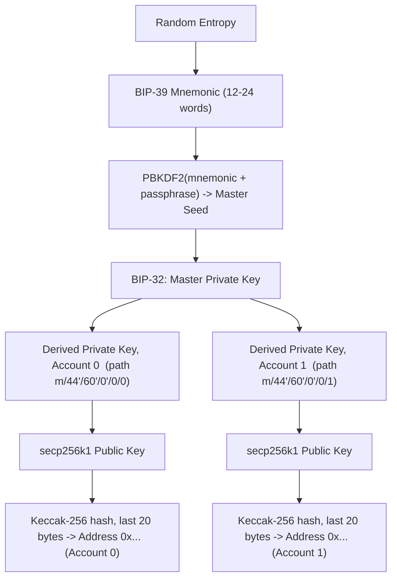

# Assignment 2: Create a Wallet Using MetaMask for Crypto Transactions

## Aim
Create a crypto wallet in MetaMask and understand the key-derivation model behind it.

## Steps to Create a Wallet

1. Install MetaMask (see Assignment 1) and open it.
2. Choose **Create a new wallet**.
3. Set a local unlock password (per-browser, not the account's real secret).
4. MetaMask generates a 12-word **Secret Recovery Phrase (seed phrase)** following the **BIP-39** standard. Write it down on paper, offline — never store it in a screenshot, note app, or cloud drive.
5. Confirm the phrase by re-entering the words in order when prompted.
6. MetaMask derives the first account's address automatically (`Account 1`). This address (`0x...`) is what you share to receive funds.
7. To view the address: click the account name at the top of the MetaMask popup — it copies the full `0x...` address to the clipboard.
8. To receive test funds: copy the address, paste it into a testnet faucet (e.g. Sepolia faucet), submit, and wait for the faucet's transaction to be mined.
9. To switch networks: use the network dropdown at the top-left of MetaMask and pick Ethereum Mainnet, Sepolia, or add a custom RPC network (chain ID, RPC URL, currency symbol, block explorer URL).
10. To create additional accounts under the same seed phrase: click the account icon -> **Add account** -> **Create account**. Each new account is a new derived key, still recoverable from the same seed phrase.

## Seed Phrase -> Private Key -> Address: The Derivation Chain

MetaMask (like most wallets) follows two Bitcoin-originated standards adapted for Ethereum:

- **BIP-39**: turns a random number into a human-readable mnemonic (12 or 24 words from a fixed wordlist). The phrase + an optional passphrase is hashed (PBKDF2) into a single large number called the **master seed**.
- **BIP-32 (HD wallets)**: the master seed is used to derive a tree of keys — a **master private key**, from which many **child private keys** can be deterministically derived using an index path (Ethereum commonly uses path `m/44'/60'/0'/0/n`, where `n` is the account index). "Deterministic" means the same seed phrase always regenerates the same tree of keys, which is why writing down only the 12 words is enough to recover every account.
- Each derived **private key** is run through elliptic-curve math (secp256k1) to get a **public key**, and the public key is hashed (Keccak-256, last 20 bytes) to get the **Ethereum address** shown in MetaMask.

## Security Practices

- **Never share the seed phrase** with anyone, any website, or any "support" request — no legitimate service ever asks for it. Anyone with the seed phrase controls every account derived from it, on every chain.
- Never type the seed phrase into a browser form; MetaMask itself only ever asks for it during wallet import/recovery, inside the extension itself.
- Keep an offline, physical backup (paper, or a metal plate) rather than a digital file or photo.
- Use the account password to protect against casual local access, but treat the seed phrase as the real root of trust — the password alone cannot recover funds on a new device.
- For larger holdings, use a **hardware wallet** (e.g. Ledger/Trezor) paired with MetaMask: the private key stays on the physical device and never touches the browser or OS, so malware on the computer cannot exfiltrate it. Every signature still requires a physical button press on the hardware device.
- Double-check the network and recipient address before confirming any transaction — EVM transactions are irreversible once mined.

## Viewing / Receiving / Switching Networks (Recap)

- **View address**: click the account name/avatar in MetaMask -> copies `0x...` address.
- **Receive test funds**: share that address with a testnet faucet or another wallet on the same network.
- **Switch networks**: network dropdown (top-left) -> select Mainnet / Sepolia / add custom network.

## Key Terms
- **BIP-39**: standard for turning random entropy into a 12/24-word mnemonic phrase.
- **BIP-32 (HD wallet)**: standard for deterministically deriving a tree of keys from one master seed.
- **Master seed**: PBKDF2(mnemonic + passphrase); root of all derived keys.
- **Derivation path**: e.g. `m/44'/60'/0'/0/0`, selects which child key to derive.
- **Private key -> Public key -> Address**: secp256k1 math, then Keccak-256 hash (last 20 bytes).
- **Hardware wallet**: keeps the private key on a separate physical device, never exposed to the browser/OS.

## Viva Questions
1. **What is a seed phrase and why does it matter?** A 12-24 word mnemonic (BIP-39) that regenerates every key the wallet holds; anyone with it controls all derived accounts.
2. **What makes a wallet "HD" (hierarchical deterministic)?** It derives an unlimited tree of key pairs from one seed using BIP-32, instead of storing one key per account.
3. **How is an Ethereum address obtained from a private key?** Derive the public key via secp256k1, Keccak-256 hash it, take the last 20 bytes.
4. **Why should the seed phrase never be typed into a website?** Any site or person with it can derive every private key and drain every account instantly; no legitimate service ever needs it.
5. **What extra protection does a hardware wallet give over a software wallet like MetaMask alone?** The private key never leaves the physical device; even a compromised computer can't exfiltrate it, and every signature needs a physical confirmation.
6. **Does creating a second account in MetaMask need a new seed phrase?** No — it's just the next index on the same derivation path, recoverable from the same original seed phrase.
