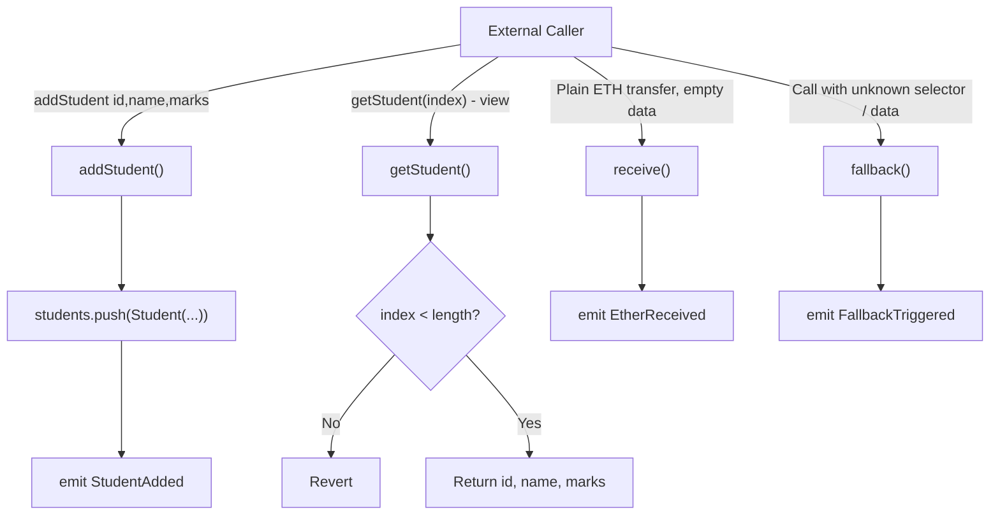

# Assignment 4: Student Data Smart Contract (Structures, Arrays, Fallback Function)

## Aim
Write a Solidity program that stores student data using a structure and a dynamic array, deploy it as a smart contract, and observe gas/fee behavior — including what happens when the contract is called with no matching function or sent plain Ether (fallback / receive).

## Solidity Contract

```solidity
// SPDX-License-Identifier: MIT
pragma solidity ^0.8.0;

contract StudentData {
    struct Student {
        uint256 id;
        string name;
        uint256 marks;
    }

    Student[] private students;

    event StudentAdded(uint256 indexed id, string name, uint256 marks);
    event FallbackTriggered(address indexed caller, bytes data, uint256 value);
    event EtherReceived(address indexed caller, uint256 value);

    // Add a new student record to the dynamic array.
    function addStudent(uint256 _id, string calldata _name, uint256 _marks) external {
        students.push(Student(_id, _name, _marks));
        emit StudentAdded(_id, _name, _marks);
    }

    // Fetch a student record by its index in the array.
    function getStudent(uint256 index)
        external
        view
        returns (uint256 id, string memory name, uint256 marks)
    {
        require(index < students.length, "Index out of range");
        Student storage s = students[index];
        return (s.id, s.name, s.marks);
    }

    // Total number of students stored.
    function studentCount() external view returns (uint256) {
        return students.length;
    }

    // Called when plain Ether is sent to the contract with no data (e.g. a simple transfer).
    receive() external payable {
        emit EtherReceived(msg.sender, msg.value);
    }

    // Called when no function matches the call (wrong function selector / unexpected data),
    // or when Ether is sent together with data that doesn't match any function.
    fallback() external payable {
        emit FallbackTriggered(msg.sender, msg.data, msg.value);
    }
}
```

Notes on the code:
- `Student` is a `struct` with three fields; `students` is a dynamic `Student[]` array living in contract storage.
- `addStudent` uses `.push(...)` to grow the array — each call costs gas proportional to writing a new struct's fields to storage.
- `getStudent` is `view` and returns the three fields of one record by index, bounds-checked with `require`.
- `receive()` fires only for a plain ETH transfer with empty call data (e.g. MetaMask's "Send" with no data field).
- `fallback()` fires for any call whose function selector doesn't match a declared function (e.g. calling a typo'd function name, or sending data the ABI doesn't recognize) — both are marked `payable` so the contract can still accept value in either case instead of reverting.

## Deployment Steps (Remix IDE)

1. Paste the contract into a new `StudentData.sol` file in Remix.
2. Compile with a `^0.8.0`-compatible compiler version.
3. In **Deploy & Run Transactions**, set the environment to **Injected Provider - MetaMask** (connected to a testnet, e.g. Sepolia) and deploy. Confirm the deployment transaction in MetaMask.
4. Call `addStudent(1, "Alice", 85)` from the deployed-contract panel — confirm in MetaMask (state-changing, costs gas).
5. Call `getStudent(0)` (blue "call" button) — returns `(1, "Alice", 85)` instantly, no gas, since it is a `view` call.
6. Call `studentCount()` similarly to confirm the array length.
7. To trigger `fallback()`: in Remix's "Low level interactions" box under the deployed contract, enter arbitrary calldata (e.g. `0x12345678`, a selector that matches no function) and click **Transact** — this invokes `fallback()`.
8. To trigger `receive()`: in the same "Low level interactions" box, leave the calldata field empty, set a Value, and click **Transact** — this sends plain ETH to the contract address and invokes `receive()`.

## Contract Structure / Flow



## Gas Cost Discussion

| Call | Relative gas cost | Why |
| --- | --- | --- |
| `getStudent(index)` / `studentCount()` | None (off-chain `view` call) | Read-only, no storage write. |
| `addStudent(...)` | Highest of the state-changing calls | Growing a dynamic array means writing a new array length *and* a new struct (three fields) to storage — each fresh `SSTORE` into previously-zero storage is the most expensive storage operation in the EVM gas model. A `string` field (`name`) adds further cost proportional to its byte length. |
| `receive()` (plain ETH, no data) | Low | No storage write happens unless the function body is changed to record something; here it only emits an event (relatively cheap compared to an `SSTORE`) and forwards no further computation. |
| `fallback()` (unmatched call) | Low to moderate | Same as `receive()` here — only an event emission — but in general a fallback could contain arbitrary logic, so its cost depends entirely on what it is written to do. |

In short, writing new structured data into an array is the most gas-expensive action in this contract; trigger paths that only emit an event (fallback/receive as written here) are comparatively cheap state-changing calls.

## Key Terms
- **`struct`**: groups related fields (`id`, `name`, `marks`) into one type.
- **Dynamic array (`Student[]`)**: grows with `.push(...)`.
- **`receive()`**: runs on a plain ETH transfer with empty call data.
- **`fallback()`**: runs when no function selector matches (or data is sent that nothing recognizes).
- **`calldata` vs `memory`**: `calldata` for external read-only function parameters (cheaper), `memory` for local copies you can modify.

## Viva Questions
1. **What triggers `receive()` vs `fallback()`?** `receive()` fires for a plain ETH send with no data; `fallback()` fires when call data doesn't match any declared function selector.
2. **Why mark both `receive()` and `fallback()` as `payable`?** So the contract can accept ETH through either path instead of reverting unrecognized calls that carry value.
3. **Why is `addStudent` more gas-expensive than `getStudent`?** It writes a brand-new struct into storage (array length + three fields), and fresh `SSTORE`s are the EVM's most expensive operation; `getStudent` is a `view` call with no write.
4. **What happens if `getStudent` is called with an out-of-range index?** The `require(index < students.length, ...)` check reverts the call.
5. **Why use a `struct` instead of three separate arrays (ids[], names[], marks[])?** Keeps one student's related fields together, clearer code, and avoids the bug risk of parallel arrays going out of sync.
6. **What's the difference between a contract with no fallback and one with it, when called incorrectly?** Without a `fallback()`, a call to an unknown function (or plain ETH with no `receive()`) simply reverts; with it, the contract can handle that case gracefully (e.g. log it).
