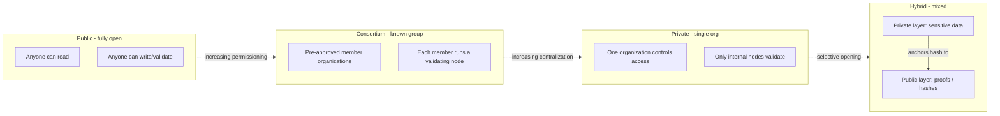

# Assignment 5: Survey Report on Types of Blockchains and Their Real-Time Use Cases

## Aim
Survey the major categories of blockchain networks and discuss real-world use cases for each.

## Overview

A blockchain's "type" is mainly about **who can participate** (read, write, validate) — this governs its trust model, performance and the kind of problems it is suited to.

### 1. Public Blockchain
Fully open and permissionless: anyone can join, read the ledger, submit transactions, and (depending on consensus) participate in validation. Trust is distributed across many independent, often anonymous participants, secured by economic incentives (mining rewards, staking) rather than a central authority.
- **Examples**: Bitcoin, Ethereum.
- **Use cases**: peer-to-peer payments and remittances (Bitcoin), decentralized finance — lending, trading, stablecoins (Ethereum and its DeFi ecosystem), NFTs and digital ownership, censorship-resistant applications.

### 2. Private Blockchain
Access and write permissions are restricted to a single organization. A central authority controls who can join and validate; it behaves much like a traditional distributed database with blockchain-style immutability and auditability layered on top.
- **Examples**: Hyperledger Besu or Quorum deployed internally by a single company; an enterprise-run permissioned Ethereum fork.
- **Use cases**: internal record-keeping and audit trails within a company, internal asset tracking, document verification within one organization, where decentralization across unrelated parties isn't the goal — tamper-evidence and a single source of truth is.

### 3. Consortium (Federated) Blockchain
A middle ground: validation is controlled by a pre-selected group of organizations (a consortium) rather than one company or the entire public. Each member runs a node and participates in consensus/governance.
- **Examples**: Hyperledger Fabric deployments run jointly by banks or supply-chain partners; trade and logistics networks like TradeLens-style consortiums.
- **Use cases**: supply-chain tracking across multiple companies (manufacturer, shipper, retailer all see the same ledger), trade finance and letter-of-credit processing between banks, interbank settlement among a known set of financial institutions.

### 4. Hybrid Blockchain
Combines private and public elements — some data/processes are kept in a permissioned, private layer while other data (or proofs/hashes of it) is published to a public chain for verifiability, or access is selectively opened to specific outside parties.
- **Examples**: enterprise platforms that anchor hashes of private records onto a public chain (e.g. a private healthcare records system periodically committing a hash to Ethereum for tamper-proof timestamping); government citizen-record systems that keep sensitive data private but let citizens or auditors verify integrity publicly.
- **Use cases**: healthcare records (private patient data kept off public chains for compliance, but integrity proofs published publicly), government land-registry or identity systems needing both confidentiality and public auditability, selective B2B data sharing where some partners get full access and the public gets verifiable proofs only.

## Comparison Table

| Aspect | Public | Private | Consortium | Hybrid |
| --- | --- | --- | --- | --- |
| Decentralization | Very high | Low (single org) | Medium (fixed group) | Mixed |
| Permissioning | None — open to anyone | Fully permissioned, one owner | Permissioned, multiple pre-approved members | Partially permissioned |
| Speed / Throughput | Lower (global consensus, many nodes) | High (few trusted nodes) | Medium-high (known, smaller validator set) | Depends on split between layers |
| Typical Consensus | Proof of Work / Proof of Stake | PBFT / Raft / simple leader-based | PBFT / Raft-style voting among members | Varies per layer |
| Example Networks | Bitcoin, Ethereum | Internal Hyperledger/Quorum deployments | Hyperledger Fabric consortiums, trade networks | Private system anchoring hashes to a public chain |
| Trust model | Trustless, economically incentivized | Trusted single operator | Trusted, known set of members | Mixed trust |

## Visual Comparison

## Summary

Blockchain type is fundamentally a trade-off between **decentralization/openness** and **performance/control**. Public chains maximize trustlessness and censorship resistance at the cost of throughput; private chains maximize speed and control at the cost of decentralization; consortium chains balance the two among a known set of trusted-but-independent parties; hybrid designs let an organization keep sensitive operations private while still publishing verifiable proofs to a public chain for auditability.

## Key Terms
- **Public blockchain**: open to anyone, fully decentralized (Bitcoin, Ethereum).
- **Private blockchain**: single organization controls access and validation.
- **Consortium blockchain**: a fixed, pre-approved group of organizations validates together (Hyperledger Fabric).
- **Hybrid blockchain**: mixes a private layer with public verifiability (e.g. anchoring hashes on-chain).
- **Permissioning**: who is allowed to read/write/validate on the network.
- **Throughput trade-off**: more decentralization generally means lower throughput, and vice versa.

## Viva Questions
1. **What is the main difference between a public and a private blockchain?** Public: open to anyone, trustless, decentralized consensus. Private: a single org controls access and validation, like an internal database with immutability.
2. **Give a real-world use case for a consortium blockchain.** Supply-chain tracking or trade finance shared among a known set of banks/companies (e.g. Hyperledger Fabric deployments).
3. **Why would a healthcare system use a hybrid blockchain?** Keep sensitive patient data private/off-chain for compliance, but publish a hash to a public chain so record integrity can still be independently verified.
4. **Which type typically has the highest throughput, and why?** Private — fewer, trusted validating nodes, no need for costly global consensus like Proof of Work.
5. **Which type typically has the strongest censorship resistance?** Public — no single party can block transactions or exclude validators.
6. **Name the typical consensus mechanisms for public vs. consortium chains.** Public: Proof of Work / Proof of Stake. Consortium: PBFT or Raft-style voting among known members.
