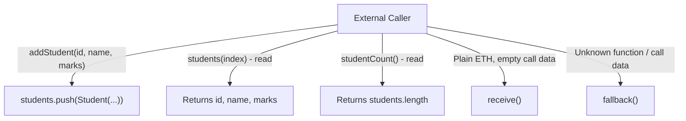

# Assignment 4: Student Data Smart Contract (Structures, Arrays, Fallback Function)

## Aim
Write a program in Solidity to create Student data. Use structures, arrays and a fallback function. Deploy it as a smart contract and observe the transaction fee and gas values.

## Solidity Contract

The same code is in `../4_StudentData.sol`.

```solidity
// SPDX-License-Identifier: MIT
pragma solidity ^0.8.0;

contract StudentData {
    struct Student {
        uint256 id;
        string name;
        uint256 marks;
    }

    Student[] public students;

    function addStudent(uint256 id, string calldata name, uint256 marks) external {
        students.push(Student(id, name, marks));
    }

    function studentCount() external view returns (uint256) {
        return students.length;
    }

    receive() external payable {}

    fallback() external payable {}
}
```

Notes on the code:
- **Structure**: `Student` groups three fields into one type.
- **Array**: `students` is a dynamic `Student[]` in contract storage. `addStudent` grows it with `.push(...)`.
- `students` is `public`, so Solidity generates a getter automatically: `students(index)` returns the `id`, `name` and `marks` of one record. No hand-written getter is needed.
- `studentCount()` returns the array length, which the automatic getter does not expose.
- **`receive()`** runs when plain Ether is sent to the contract with empty call data.
- **`fallback()`** runs when the call data matches no function in the contract.
- Both are `payable` and have empty bodies: they accept the call (and any Ether) instead of reverting. Without them, such a call would fail.

## Deployment Steps (Remix IDE)

1. Open `remix.ethereum.org` and paste the contract into a new file `StudentData.sol`.
2. Compile with a `0.8.x` compiler.
3. In **Deploy & Run Transactions**, pick **Remix VM** (no wallet needed) or **Injected Provider - MetaMask** (a testnet such as Sepolia), then click **Deploy**.
4. Call `addStudent(1, "Alice", 85)`. This changes state, so it costs gas.
5. Call `students(0)`. It returns `(1, "Alice", 85)` with no gas, because it is a read.
6. Call `studentCount()`. It returns `1`.
7. To trigger `fallback()`: in **Low level interactions**, enter call data that matches no function, for example `0x12345678`, and click **Transact**.
8. To trigger `receive()`: leave the call data empty, set a **Value**, and click **Transact**.
9. After each transaction, expand it in the Remix console to read its `gas`, `transaction cost` and `execution cost`.

## Contract Structure / Flow



## Gas Cost Discussion

| Call | Relative gas cost | Why |
| --- | --- | --- |
| `students(index)` / `studentCount()` | None when called as a read | Nothing is written to storage. |
| `addStudent(...)` | Highest | It writes a new array length and a new struct with three fields. Writing to previously empty storage (`SSTORE`) is the most expensive operation in the EVM. A longer `name` costs more. |
| `receive()` / `fallback()` | Low | The bodies are empty, so the cost is close to the 21,000 base fee of any transaction. |

Deploying the contract also costs gas, since it stores the contract's bytecode on the chain.

## Key Terms
- **`struct`**: groups related fields (`id`, `name`, `marks`) into one type.
- **Dynamic array (`Student[]`)**: grows with `.push(...)`.
- **Public state variable**: gets an automatic getter function.
- **`receive()`**: runs on a plain ETH transfer with empty call data.
- **`fallback()`**: runs when no function matches the call data.
- **`calldata`**: read-only location for external function arguments, cheaper than copying them to `memory`.

## Viva Questions
1. **What triggers `receive()` vs `fallback()`?** `receive()` runs for a plain ETH send with no data; `fallback()` runs when the call data matches no function.
2. **Why mark both as `payable`?** So the contract can accept ETH through either path instead of reverting.
3. **Why is `addStudent` more expensive than reading a student?** It writes a new struct into storage, and storage writes are the most expensive EVM operation. A read writes nothing.
4. **What happens if `students(index)` is called with an index out of range?** The call reverts; Solidity checks array bounds automatically.
5. **Why use a `struct` instead of three separate arrays?** It keeps one student's fields together and avoids parallel arrays going out of sync.
6. **What happens without a fallback function?** A call to an unknown function, or plain ETH sent to a contract with no `receive()`, reverts.
7. **Why are the function bodies of `receive()` and `fallback()` empty?** The assignment only needs the contract to accept such calls. A fallback can contain any logic, and its gas cost then depends on that logic.
